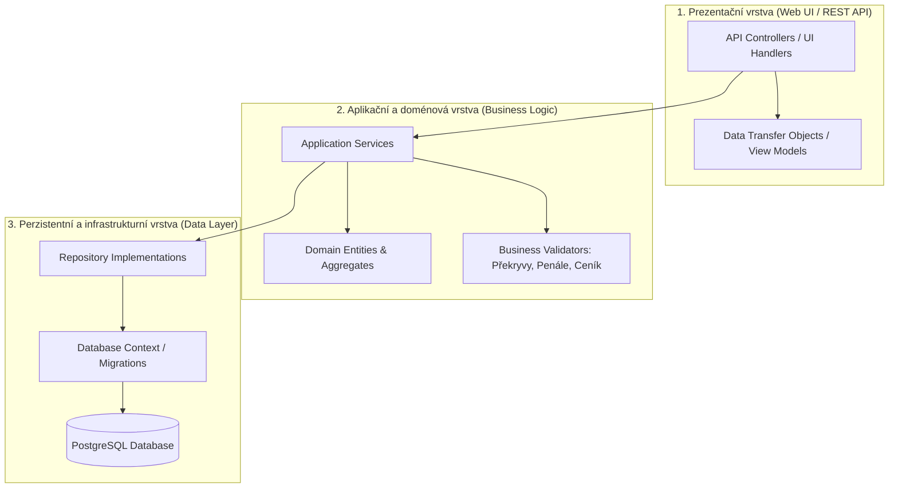
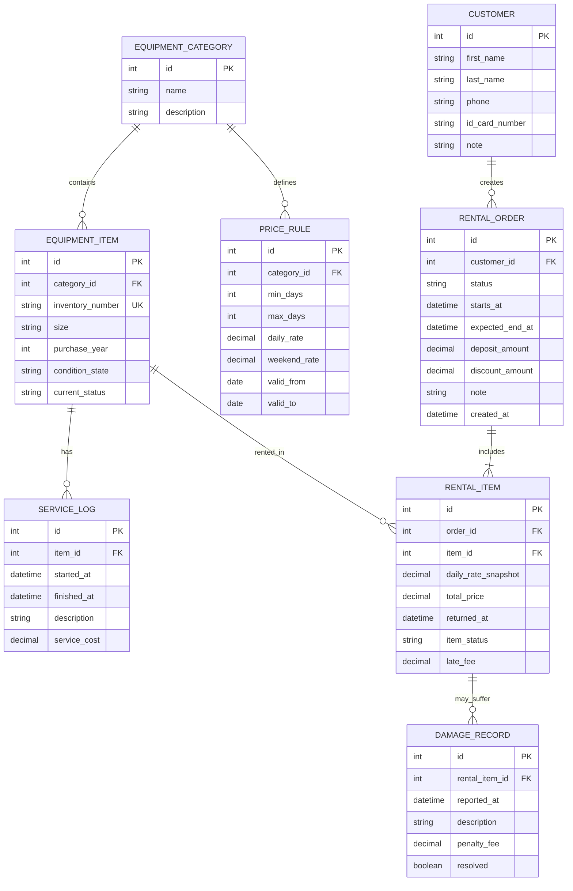

# Půjčovna vybavení – Hory a voda (PPRO)

[](#)
[](#)
[](#)
[](#)

Technická dokumentace, kompletní zadání, doménový model a seznam architektonických rozhodnutí pro semestrální projekt z předmětu **Pokročilé programování (PPRO)** na FIM UHK (ZS 2026/2027).

> [!IMPORTANT]
> **Jediný zdroj pravdy (SSOT):** Tento dokument slouží jako centrální technická dokumentace projektu. Každá změna architektury, nové rozhodnutí nebo rozšíření kódu musí být neprodleně a konzistentně zaznamenány v tomto souboru. Pro pravidla chování vývojáře a AI asistenta viz [AGENTS.md](file:///c:/Users/mento/Documents/skola/PRPA/AI_is_the_way/AGENTS.md).

---

## Obsah
1. [Zadání klienta](#1-zadání-klienta)
2. [Klíčový bod návrhu – Kde se návrh láme](#2-klíčový-bod-návrhu--kde-se-návrh-láme)
3. [Seznam architektonických a doménových rozhodnutí](#3-seznam-architektonických-a-doménových-rozhodnutí)
4. [Architektonický návrh a společné minimum](#4-architektonický-návrh-a-společné-minimum)
5. [Doménový a datový model](#5-doménový-a-datový-model)
6. [Instalace a spuštění](#6-instalace-a-spuštění)
7. [Testovací strategie](#7-testovací-strategie)
8. [Deník postupu a změn (Changelog)](#8-deník-postupu-a-změn-changelog)

---

## 1. Zadání klienta

**Klient:** Martin Řehák, *Hory a voda*  
**Předmět podnikání:** Půjčovna lyží, snowboardů a v létě lodí. Sezóna je krátká a o víkendech se stojí fronta.

### 1.1 Jak to mají dnes
- Papírový sešit a inventární čísla napsaná lihovkou přímo na vybavení.
- Rezervace se přijímají telefonicky a píšou se na lístečky připíchnuté na nástěnce nad pultem.
- V sezóně dochází k chybám – jeden pár lyží se slíbí dvakrát:
  > *„V sobotu ráno nemám čas to řešit, tak vždycky někomu dám něco jiného a slevím.“*

### 1.2 Co klient chce (Funkční požadavky)
1. **Jednotlivé kusy vybavení**: Každý kus má inventární číslo, kategorii, velikost, rok pořízení a stav opotřebení. Kusy jsou skutečně individuální: dva stejné páry lyží představují dva samostatné záznamy v databázi.
2. **Kategorie vybavení**: Lyže, snowboardy, boty, hole, lodě, vesty. Podle kategorie se primárně počítá cena.
3. **Zákazníci**: Jméno, příjmení, telefon, číslo dokladu totožnosti, kauce.
4. **Výpůjčky**: Jedna výpůjčka může obsahovat několik kusů (např. set lyže + boty + hole), má datum od a do a tentýž kus se v čase půjčuje opakovaně.
5. **Rezervace dopředu**: Zákazník zavolá v úterý, že v sobotu přijede – systém musí umožnit vytvořit rezervaci na budoucí období.
6. **Vrácení i po částech**: Stává se, že zákazník vrátí lyže v poledne, ale boty si nechá až do večera. Systém musí umět zaznamenat vrácení jednotlivých kusů samostatně.
7. **Servis vybavení**: Kus jde na servis a po tuto dobu se nesmí půjčovat ani rezervovat. Klient chce přehledně vidět, co je zrovna v servisu a jak dlouho.
8. **Ceník podle kategorie a počtu dní**: Víkend se počítá jako dva dny, *„ale bereme to od pátku odpoledne“*.
9. **Manažerské přehledy**:
   - Co je právě venku (aktivní výpůjčky).
   - Co mělo být vráceno a nebylo (prodlení).
   - Statistika četnosti výpůjček jednotlivých kusů (podklad pro rozhodnutí, jaké vybavení dokoupit a jaké vyřadit).

### 1.3 Na čem klient trvá (Obchodní pravidla)
- ❌ **Žádný překryv**: Jeden kus nesmí být ve dvou výpůjčkách nebo rezervacích, které se časově překrývají. Ani omylem, ani ručně.
- 🛠️ **Blokace servisu**: Kus v servisu se nepůjčuje.
- ⏱️ **Penále za prodlení**: Za pozdní vrácení se účtuje penále za každý započatý den prodlení.
- 📜 **Trvalá historie**: Historie výpůjček kusu se nikdy nemaže – slouží k řešení reklamací a plánování obměny inventáře.

### 1.4 Co klient prohodil mimochodem (Přání a poznámky)
- *„Nejvíc mi pomůže, když v sobotu ráno uvidím na jedné obrazovce, co je volné.“* (Priorita pro UI)
- *„Kauci beru v hotovosti, to do počítače dávat nemusíme.“* (Systém eviduje výši složené kauce pro kontrolu vrácení, ale neřeší platební bránu)
- *„Někdy dám slevu, to je moje věc.“* (Systém musí umožnit manuální korekci celkové částky výpůjčky)
- *„Kdyby to šlo tisknout, tak bych tiskl smlouvu.“* (Příprava podkladů pro tisk smlouvy/protokolu o výpůjčce)

---

## 2. Klíčový bod návrhu – Kde se návrh láme

> **Zadání D: Rezervace konkrétního kusu proti rezervaci typu / kapacity**

### Podstata problému:
Při telefonickém rozhovoru v úterý zákazník říká: *„Potřebuji na víkend sjezdové lyže délky 170 cm a boty velikosti 42.“* Zákazník nezná inventární číslo `SKI-0412` ani stav jednotlivých kusů.
- **Riziko čisté rezervace typu (kapacity):** Pokud systém eviduje pouze počet kusů v kategorii/velikosti bez vazby na konkrétní inventární čísla, vzniká v sobotu ráno chaos. Obsluha u pultu musí manuálně hledat, který konkrétní kus ze skladu vydat, a snadno může dojít ke kolizi s jiným zákazníkem, který má speciální požadavek, nebo k opomenutí servisní odstávky.
- **Riziko vynucené manuální volby kusu po telefonu:** Pokud systém nutí obsluhu projít inventární seznam 50 párů lyží a ručně vybrat číslo `412`, hovor trvá neúměrně dlouho a systém je v praxi nepoužitelný.

### Naše architektonické řešení:
Zvolen je **hybridní alokační model s automatickým přiřazením kusu**:
1. Obsluha při rezervaci zadá požadovanou kategorii a velikost (např. *Lyže carving, 170 cm*).
2. Systém provede **automatickou alokaci** – najde první dostupný, neservisovaný a na daný termín neobsazený kus (`EquipmentItem`) a prováže jej s rezervací (`RentalItem`).
3. Tento kus je tím pádem časově zablokován a nemůže dojít k overbookingu.
4. **Flexibilita při výdeji (sobota ráno):** Pokud zákazník dorazí k pultu a obsluha zjistí, že zákazníkovi lépe vyhovuje jiný kus nebo chce zákazník jiný model, systém umožňuje jedním klikem změnit alokovaný kus za libovolný jiný volný kus v dané kategorii/velikosti.

---

## 3. Seznam architektonických a doménových rozhodnutí

V souladu s metodikou PPRO jsou níže uvedena explicitní řešení otevřených bodů klienta:

### Rozhodnutí 1: Konkrétní kus vs. typ (Otevřený bod 1)
- **Rozhodnutí:** Rezervace se na rozhraní zadává podle typu a velikosti, ale v databázi se okamžitě automaticky přiřadí konkrétní unikátní kus (`EquipmentItem`). Při výdeji má obsluha možnost kus snadno změnit (swap).
- **Důvod:** Zaručuje splnění striktního pravidla klienta (*žádný kus nesmí mít překrývající se rezervace*), eliminuje overbooking a zároveň nezdržuje operátora při telefonické rezervaci.

### Rozhodnutí 2: Životní cyklus a expirace rezervace (Otevřený bod 2)
- **Rozhodnutí:** Rezervace drží garanci do 10:00 hod. v den zahájení výpůjčky. V 10:00 systém nabídne obsluze rychlé storno nevyzvednutých rezervací (`EXPIRED`), čímž se zablokované kusy uvolní pro lidi stojící ve frontě.
- **Důvod:** Chrání půjčovnu před blokováním inventáře nespolehlivými zákazníky během špičky a dává obsluze nástroj pro okamžité uspokojení zákazníků na prodejně.

### Rozhodnutí 3: Evidence poškození a vazba na kauci (Otevřený bod 3)
- **Rozhodnutí:** Poškození je evidováno entitou `DamageRecord`, která je navázána na položku výpůjčky (`RentalItem`), inventární kus (`EquipmentItem`) a zákazníka. Umožňuje stržení stanovené částky z kauce a automatické převedení kusu do stavu `IN_SERVICE`.
- **Důvod:** Zajišťuje transparentní historii zacházení s vybavením, prokazatelnost škody při reklamacích a okamžité vyřazení poškozeného kusu z nabídky do jeho opravy.

### Rozhodnutí 4: Částečné vrácení a výpočet penále (Otevřený bod 4)
- **Rozhodnutí:** Výpůjčka (`RentalOrder`) je agregát složený z jednotlivých položek (`RentalItem`). Každá položka má vlastní stav (`RENTED`, `RETURNED`) a přesné datum vrácení (`returned_at`). Penále za pozdní vrácení se počítá za každý započatý den prodlení specificky pro ty kusy, které nebyly včas vráceny. Celá výpůjčka se uzavře (`CLOSED`) až po navrácení všech kusů a vyrovnání doplatků.
- **Důvod:** Odpovídá realitě, kdy zákazník vrátí lyže v poledne a boty večer. Zákazník není neprávem penalizován za včas vrácené lyže, ale půjčovna nepřijde o penále za zpožděné boty.

### Rozhodnutí 5: Změna ceníku během sezóny (Otevřený bod 5)
- **Rozhodnutí:** V okamžiku vytvoření rezervace nebo výpůjčky se provede trvalý snapshot sjednaných cen (denní sazba, vypočtená základní cena) přímo do záznamu `RentalItem`.
- **Důvod:** Změna globálního ceníku (`PriceRule`) v průběhu sezóny nijak neovlivní dříve uzavřené smlouvy a rezervace, čímž je zaručena právní a účetní stabilita.

---

## 4. Architektonický návrh a společné minimum

Projekt striktně implementuje povinné minimum předmětu PPRO:

### 4.1 Třívrstvá architektura se závislostmi jedním směrem



- **Pravidlo závislostí:** Vyšší vrstvy závisejí na nižších. Doménová vrstva neobsahuje žádné HTTP závislosti ani přímé SQL dotazy.

### 4.2 Zvolený technologický stack
- **Jazyk & Platforma:** Java 21 (Eclipse Temurin)
- **Aplikační framework:** Spring Boot 3.3.4
  - `spring-boot-starter-web` (REST API & statické servírování UI)
  - `spring-boot-starter-data-jpa` (Spring Data JPA / Hibernate)
  - `spring-boot-starter-validation` (Jakarta Validation pro DTO)
- **Databáze:** PostgreSQL 16 (v Docker kontejneru)
- **Verzování schématu:** Flyway migrace (`src/main/resources/db/migration/`)
- **Klientské rozhraní:** Responzivní webový dashboard (HTML5, Vanilla CSS, JavaScript) servírovaný přímo ze Spring Bootu na portu `8080`.
- **Testování:** JUnit 5, Mockito, H2 in-memory DB pro testovací profil.

### 4.3 REST API rozhraní
| Metoda | Endpoint | Popis |
|---|---|---|
| `GET` | `/api/items` | Seznam kusů inventáře (filtrace: `categoryId`, `status`) |
| `GET` | `/api/items/{id}` | Detail konkrétního kusu vybavení |
| `POST` | `/api/items` | Zaevidování nového kusu do inventáře |
| `PATCH` | `/api/items/{id}/status` | Změna stavu kusu (odeslání / návrat ze servisu) |
| `GET` | `/api/categories` | Číselník kategorií vybavení |
| `POST` | `/api/orders/reservations` | Telefonická rezervace s automatickou alokací volného kusu |
| `GET` | `/api/orders` | Seznam výpůjček a rezervací (filtr: `status`) |
| `GET` | `/api/orders/{id}` | Detail výpůjčky s položkami a snapshotem cen |
| `GET` | `/api/orders/by-number/{orderNumber}` | Dohledání výpůjčky podle čísla smlouvy |
| `POST` | `/api/orders/{id}/handout` | Výdej u pultu v sobotu ráno (zápis kauce a slevy) |
| `GET` | `/api/orders/items/{rentalItemId}/available-swaps` | Volné kusy téže kategorie, za které lze u pultu vyměnit |
| `POST` | `/api/orders/{id}/items/{itemId}/swap` | Blesková výměna kusu u pultu (Swap kusu) |
| `POST` | `/api/orders/{id}/items/{itemId}/return` | Částečné vrácení položky (penále za prodlení, poškození -> servis) |
| `POST` | `/api/orders/{id}/cancel` | Storno rezervace (zůstává v historii jako `CANCELLED`) |
| `POST` | `/api/orders/expire-unclaimed` | Zrušení nevyzvednutých rezervací po 10:00 hod. |
| `GET` | `/api/customers?query=...` | Seznam zákazníků, volitelně hledání podle jména či telefonu |
| `GET` | `/api/customers/{id}` | Detail zákazníka |
| `GET` | `/api/customers/by-phone/{phone}` | Vyhledání zákazníka podle telefonu při hovoru |
| `POST` | `/api/customers` | Založení nového zákazníka |
| `GET` | `/api/price-rules` | Kompletní ceník kategorií a víkendových balíčků |
| `GET` | `/api/reports/active-rentals` | Přehled: Co je právě zapůjčeno venku |
| `GET` | `/api/reports/overdue` | Přehled: Co mělo být vráceno a není (včetně vyčíslení penále) |
| `GET` | `/api/reports/item-usage` | Statistika četnosti výpůjček a tržeb kusů (podklad pro nákup/vyřazení) |
| `GET` | `/api/reports/availability-matrix?date=YYYY-MM-DD` | Sobotní ranní matice volných kusů (kategorie × velikost) |
| `GET` | `/api/reports/active-services` | Přehled servisní dílny: co je v servisu a jak dlouho |

> Dnešní výdeje a očekávaná vrácení na obrazovce „Sobota ráno“ skládá UI z `/api/orders?status=RESERVATION` a `/api/orders?status=ACTIVE`.

---

## 5. Doménový a datový model

Systém obsahuje 8 provázaných entit a plnohodnotnou vazbu M:N, čímž výrazně převyšuje povinné minimum.



### Přehled entit:
1. **`EquipmentCategory`**: Číselník kategorií vybavení (Lyže, Snowboardy, Boty, Hole, Lodě, Vesty).
2. **`EquipmentItem`**: Konkrétní fyzický kus označený inventárním číslem, velikostí a stavem (AVAILABLE, RESERVED, RENTED, IN_SERVICE, RETIRED).
3. **`Customer`**: Zákazník se jménem, telefonem a číslem dokladu.
4. **`RentalOrder`**: Zastřešující doklad rezervace nebo výpůjčky (agregát).
5. **`RentalItem`**: Vazební M:N entita reprezentující konkrétní zapůjčený kus v rámci výpůjčky se snapshotem ceny, stavem a penále.
6. **`DamageRecord`**: Evidence škodní události spojené s výpůjčkou a kusem.
7. **`ServiceLog`**: Evidence servisních odstávek a oprav kusu.
8. **`PriceRule`**: Ceníková pravidla podle kategorií, délky výpůjčky a víkendových balíčků.

---

## 6. Instalace a spuštění

### Požadavky
- [Docker Desktop](https://www.docker.com/) a [Docker Compose](https://docs.docker.com/compose/)
- [Git](https://git-scm.com/)

*(Pozn.: Na hostitelském počítači není nutné mít nainstalovanou Javu ani Maven; multi-stage Dockerfile provede kompilaci a spuštění izolovaně uvnitř kontejneru).*

### Krok za krokem
1. Naklonujte repozitář:
   ```bash
   git clone https://github.com/TomasPukansky/AI_is_the_way.git
   cd AI_is_the_way
   ```
2. Nastavte si lokální git hooky (pokud nejsou automaticky aktivní):
   ```bash
   git config core.hooksPath .githooks
   ```
3. Spusťte celou aplikaci včetně PostgreSQL a migrací:
   ```bash
   docker compose up --build
   ```
4. Otevřete webový prohlížeč na adrese:
   - **Klientský dashboard (Sobotní pult):** [http://localhost:8080](http://localhost:8080)
   - **REST API:** [http://localhost:8080/api/items](http://localhost:8080/api/items)

---

## 7. Testovací strategie

Pro zajištění stability klíčových obchodních pravidel projekt zahrnuje:

1. **Unit testy doménových pravidel (`EquipmentBusinessRulesTest`)**:
   - Ověření unikátnosti inventárního čísla (zákaz duplicit v inventáři).
   - Zákaz přímého zapůjčení kusu, který je v servisu (`IN_SERVICE`).
   - Zákaz rezervace kusu v servisu.
   - Zákaz přímého odeslání do servisu u kusu, který je právě zapůjčen zákazníkovi (bez předchozího vrácení).
   - Úspěšný přechod volného kusu do servisu se záznamem důvodu a následný bezpečný návrat do provozu.
2. **Unit testy ceníku a penále (`PricingPolicyTest`)**: denní sazba, víkendový balíček od pátku 14:00 (posuzováno v pásmu `Europe/Prague`), penále za každý započatý den prodlení.
3. **Unit testy pravidel výpůjček (`RentalServiceBusinessRulesTest`)**: zákaz překryvu termínů, blokace kusu v servisu, částečné vrácení.
4. **Integrační testy (`RentalLifecycleIntegrationTest`, Spring Boot + H2)**:
   - Průchod celým životním cyklem: telefonická rezervace (auto-alokace) $
ightarrow$ výměna kusu u pultu $
ightarrow$ výdej s kaucí $
ightarrow$ částečné vrácení (výpůjčka zůstává otevřená) $
ightarrow$ vrácení posledního kusu a uzavření.
   - Odmítnutí třetí rezervace stejného kusu na překrývající se termín (žádný overbooking).

Spuštění testů (bez lokální Javy, v Dockeru): `docker build --target builder -t ppro-rental-builder . && docker run --rm --name ppro-rental-maven ppro-rental-builder mvn -B test`  
Aktuální stav: **20 testů, 0 selhání** (2026-10-07).

---

## 8. Deník postupu a změn (Changelog)

- **2026-10-21 (Z4 – vzhled nepůsobí jako od AI)**:
  - Odstraněny emoji ze záložek navigace, ikona vlevo nahoře a štítek „Půjčovna vybavení“ vedle názvu (včetně nepoužívaných stylů).
- **2026-10-21 (Z2 – inventář po česku a na jednu obrazovku)**:
  - Štítky stavů v celém UI zobrazují české názvy (sdílená mapa `STATUS_LABELS` v `app.js`) místo hodnot enumů (AVAILABLE, IN_SERVICE…).
  - Záložka Inventář: velké karty nahrazeny kompaktním přehledem – kusy seskupené podle kategorie (počty volné, v servisu, půjčeno), jeden řádek na kus, skupiny vedle sebe; nadpis a filtry v jedné řádce.
  - Migrace `V5__rename_categories_cz.sql`: názvy kategorií bez anglicismů („Sjezdové lyže“, „Běžky“).
- **2026-10-21 (Z1 – texty UI podle klienta)**:
  - Ve všech textech UI nahrazen znak „&“ slovem „a“, lomítka ve významu „nebo“ přepsána slovy, odstraněny anglicismy (swap, set, report). Pravidlo zapsáno do AGENTS.md (oddíl 6).
- **2026-10-07 večer (Dokončení a ověření dema – Claude Code)**:
  - Odstranění zastaralých tříd z první iterace (`CustomerService`, `PricingService`, `ReportService`, `CustomerController`, `PriceRuleController`, nepoužívané DTO a 3 staré testy) – nahrazeny `RentalService(Impl)`, `CustomerAndPriceService(Impl)`, `PricingPolicy` a novými kontrolery.
  - Migrace V3: sjednocení typů ID na `BIGINT` (entity používají `Long`), `rental_items` už nemaže kaskádou (historie se nemaže).
  - Oprava: víkendový tarif se posuzuje v místním čase `Europe/Prague` (dříve UTC – pátek 14:00 se nepoznal).
  - Nové pravidlo: kus, který je právě venku nebo v servisu, nelze vydat – obsluha ho musí vyměnit; nabídka výměny neobsahuje aktuální kus; auto-alokace dává přednost kusům fyzicky na skladě.
  - Integrační test zakládá vlastní testovací inventář; přidán test proti overbookingu a test časového pásma. Build a 20 testů ověřeno v Dockeru.
- **2026-10-07 (Rozšíření na plné klientské demo – kompletní životní cyklus)**:
  - Přidání Flyway migrace `V3__create_full_rental_tables.sql` (tabulky `customers`, `price_rules`, `rental_orders`, `rental_items`, `service_logs`, `damage_records`).
  - Přidání Flyway migrace `V4__seed_full_demo_data.sql` se syntetickými zákazníky, kompletním ceníkem a dynamickými výpůjčkami/rezervacemi vztaženými k `CURRENT_DATE`.
  - Implementace doménových služeb: `RentalService` (auto-alokace bez kolizí, výdej u pultu, výměna kusů swap, částečné vrácení, storno po 10:00), `PricingPolicy` (víkendový balíček od pátku 14:00, penále za započaté dny prodlení), `CustomerAndPriceService`; přehledy jsou součástí `RentalService`.
  - Rozšíření REST API o endpointy pro objednávky, zákazníky, ceník a přehledy.
  - Implementace nového klientského webového rozhraní v `index.html`, `style.css` a `app.js` se 7 záložkami, maticí volných kusů v sobotu ráno a modulem tisku smluv.
  - Vytvoření unit testů (`PricingPolicyTest`, `RentalServiceBusinessRulesTest`) a integračního testu (`RentalLifecycleIntegrationTest`).
  - Přidání sekce 9 „Scénář ukázky pro klienta“ do technické dokumentace.
- **2026-09-30 (Implementace MVP dema pro klienta)**:
  - Volba technologického stacku: **Java 21 + Spring Boot 3.3.4 + Flyway + PostgreSQL 16**.
  - Zavedení 3-vrstvé architektury (Controllers, Services, Repositories).
  - Vytvoření Flyway migrací `V1__create_equipment_tables.sql` a `V2__seed_demo_equipment.sql` se syntetickými daty lyží, snowboardů, bot a lodí.
  - Implementace doménových pravidel a validací pro `EquipmentItem` (blokace kusů v servisu, prevence duplicitních inventárních čísel).
  - Vytvoření sady jednotkových testů `EquipmentBusinessRulesTest`.
  - Vytvoření klientského webového rozhraní (Sobotní ráno dispečink, přehled volných kusů, filtrování, odesílání do servisu a návrat).
  - Vytvoření multi-stage `Dockerfile` a `docker-compose.yml`.
- **2026-09-30 (Inicializace)**:
  - Výběr **Zadání D: Půjčovna vybavení (Hory a voda)**.
  - Vytvoření [AGENTS.md](file:///c:/Users/mento/Documents/skola/PRPA/AI_is_the_way/AGENTS.md) s pravidly pro AI asistenta (zákaz push bez svolení, povinný parametr `-m`, udržování SSOT dokumentace).
  - Vytvoření pre-commit hooku v `.githooks/pre-commit` a aktivace přes `core.hooksPath`.
  - Vytvoření kompletní technické dokumentace a zadání v [README.md](file:///c:/Users/mento/Documents/skola/PRPA/AI_is_the_way/README.md) jako jediného zdroje pravdy.
  - Detailní specifikace architektonických rozhodnutí k otevřeným bodům 1–5 klienta.

---

## 9. Scénář ukázky pro klienta (Předvedení panu Řehákovi)

Tento scénář slouží jako přesný návod, jak panu Řehákovi předvést fungování systému na reálném příběhu jeho provozu:

### Postup předvedení (7 kroků)
1. **Krok 1: Úterní telefonát (Záložka „Rezervace po telefonu“)**
   - *Příběh:* Zákazník volá v úterý: „Potřebuji na víkend carvingové lyže 170 cm a boty 42.“
   - *Ukázka:* Zadáte telefon zákazníka (automaticky se dotáhne jméno, pokud již u vás byl). Zadáte termín Pá 14:00 – Ne 18:00 (systém automaticky detekuje a aplikuje víkendový balíček).
   - *Výsledek:* Systém na jedno kliknutí zarezervuje set a **automaticky alokuje konkrétní volné kusy** (např. `SKI-002`, `BOT-042`) bez rizika překryvu s jinou objednávkou. Žádné luštění lihovky po telefonu.
2. **Krok 2: Sobota ráno – Odbavení fronty (Záložka „Sobota ráno (Dispečink)“)**
   - *Příběh:* V sobotu ráno stojí fronta před pultem a pan Řehák potřebuje okamžitý přehled.
   - *Ukázka:* Na jedné obrazovce vidí matici kategorií a velikostí s počty volných kusů (zeleně), kusů v servisu (červeně) a půjčených/rezervovaných (oranžově). Pod maticí vidí seznam dnešních rezervací k vyzvednutí.
3. **Krok 3: Expirace nevyzvednutých rezervací po 10:00**
   - *Příběh:* Je 10:05, zákaznice paní Veselá nedorazila pro rezervované lyže a nezvedá telefon. Před pultem stojí zájemci.
   - *Ukázka:* Kliknutí na tlačítko `⏰ Zrušit nevyzvednuté po 10:00`. Rezervace přejde do stavu `EXPIRED` a zablokované lyže `SKI-005` se okamžitě uvolní do fondu volných kusů pro lidi ve frontě.
4. **Krok 4: Výdej u pultu a výměna kusu (Swap)**
   - *Příběh:* Dorazí pan Procházka pro svoji rezervaci, ale raději by jiné lyže ze stojanu.
   - *Ukázka:* Tlačítkem `Swap` obsluha jedním klikem vymění přiřazené lyže za jiný volný pár. Následně klikne na `Vydat zákazníkovi`, zapíše složenou kauci (např. 1500 Kč hotově) a případnou slevu. Tlačítkem `Smlouva` vygeneruje tiskový protokol s podpisovými kolonkami pro tiskárnu.
5. **Krok 5: Částečné vrácení v poledne (Záložka „Výdej a vrácení“)**
   - *Příběh:* Zákaznice paní Kučerová vrátí v neděli v poledne lyže, ale boty si ještě nechá do večera.
   - *Ukázka:* U objednávky se klikne na `Vrátit` pouze u řádku lyží. Lyže se uvolní zpět do skladu (`RETURNED`), zatímco výpůjčka zůstává `ACTIVE` a boty jsou stále evidovány jako zapůjčené.
6. **Krok 6: Vrácení se zpožděním a poškozením**
   - *Příběh:* Večer zákazník vrací snowboard s vytrženým vázáním a s jednodenním zpožděním.
   - *Ukázka:* Obsluha označí `Zjištěno poškození`, zadá popis a částku 400 Kč k úhradě z kauce. Systém automaticky:
     - Vypočte smluvní penále za každý započatý den prodlení.
     - Vytvoří škodní záznam (`DamageRecord`).
     - Kus okamžitě přepne do `IN_SERVICE` a vytvoří zápis do servisní dílny.
7. **Krok 7: Manažerské přehledy (Záložka „Přehledy & Co dokoupit“)**
   - *Příběh:* Pan Řehák si na konci dne sedne a chce vědět, co má v oběhu a co nakoupit na příští sezónu.
   - *Ukázka:*
     - Červená tabulka dlužníků po termínu s vyčísleným naskakujícím penále.
     - Žebříček nejčastěji půjčovaného vybavení a tržeb jednotlivých kusů (jasný podklad pro rozhodnutí, jaké délky lyží dokoupit a co vyřadit).
     - Přehled servisní dílny s počtem dní, které jednotlivé kusy strávily na opravě.

---

### Seznam otevřených otázek k projednání s klientem
Při předvedení položte panu Řehákovi tyto konkrétní otázky pro ověření návrhu:
1. **Automatická alokace vs. ruční výběr:** Vyhovuje vám, že systém při telefonické rezervaci sám vybere první vhodný kus a vy máte u pultu možnost ho jedním klikem vyměnit (`Swap`), nebo chcete vždy konkrétní inventární číslo vybírat ručně už při hovoru?
2. **Časový limit garance rezervace (10:00):** Je limit 10:00 dopoledne optimální, nebo potřebujete možnost posunout časový limit hromadně (např. v případě dopravní kalamity na horách)?
3. **Evidence hotovostní kauce:** Stačí vám evidovat složenou a vrácenou kauci pouze jako částku na smlouvě, nebo chcete mít v systému samostatnou pokladní knihu hotovosti?
4. **Víkendový balíček (od pátku 14:00):** Je začátek víkendového tarifu v pátek ve 14:00 vyhovující, nebo v praxi půjčujete na víkend už od pátečního dopoledne?
5. **Výpočet penále:** Souhlasíte s pravidlem, že za každý započatý den prodlení po termínu se účtuje 1 celá denní sazba zpožděného kusu?
